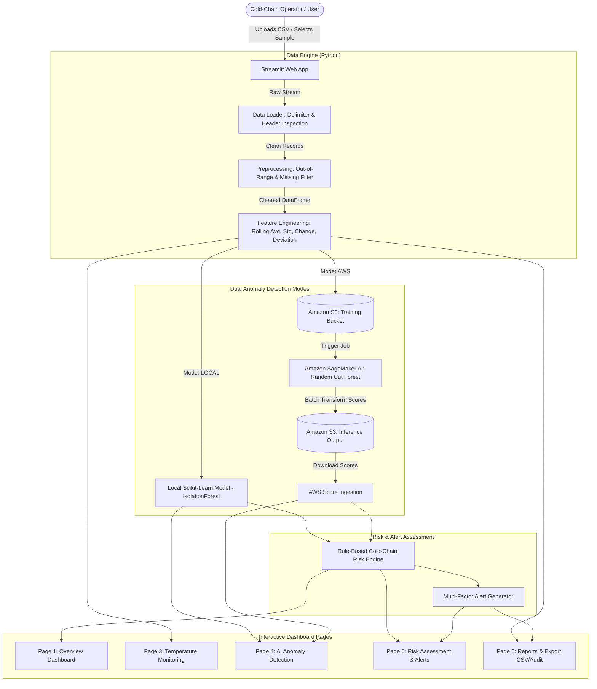

# ColdGuard AI: Cold-Chain Condition Monitoring & Early Warning System

> **AI-Enabled Cold-Chain Condition Monitoring and Early Failure-Risk Warning System**  
> Powered by Python, Streamlit, Plotly, Scikit-Learn, and Amazon Web Services (AWS S3 & Amazon SageMaker AI Random Cut Forest).

---

## 1. What the Project Does

**ColdGuard AI** is an intelligent environmental monitoring and early-risk warning platform built for temperature-controlled storage and distribution operations (cold rooms, pharmaceutical chillers, food refrigeration, and vaccine supply chains).

The system continuously evaluates time-series streams of temperature and relative humidity measurements gathered from distributed sensors (e.g., DHT22 sensors). It:
1. Ingests raw and preprocessed sensor readings from actual research archives (Zenodo Record 15130001) or live telemetry logs.
2. Computes per-sensor time-series rolling statistics without future data leakage.
3. Uses machine learning (unsupervised Random Cut Forest / tree-based isolation) to identify abnormal patterns and assign continuous anomaly scores.
4. Evaluates rule-based thermal integrity against product operating bands (such as the chilled pharmaceutical standard of 2°C to 8°C).
5. Classifies cold-chain risk into four transparent categories (**LOW**, **MODERATE**, **HIGH**, **CRITICAL**).
6. Dispatches structured alerts with plain-English reasons and operational recommendations.
7. Visualizes readings, excursions, and anomaly scores on an interactive Streamlit dashboard.

> [!NOTE]
> **Operational Disclaimer**: ColdGuard AI is intended to provide early warnings and assist cold-chain operators. It does not claim to predict mechanical failures or product spoilage with certainty.

---

## 2. Real-World Problem It Solves

Cold-chains are vulnerable to silent failures:
- **Product Spoilage & Wastage**: According to the World Health Organization (WHO), up to 50% of vaccines are wasted globally each year, in large part due to temperature control failures and compromised cold chains.
- **Inadequate Static Alarms**: Traditional systems rely on simple static alarms (e.g., "trigger if temperature > 8°C"). These static alarms fail to detect gradual compressor degradation, slow refrigerant leaks, micro-cycling, or localized thermal stratification until catastrophic failure has already occurred.
- **Sensor Glitches & False Alarms**: Single-point temperature spikes caused by routine door access or transient sensor jitter often trigger false alarms, causing alert fatigue.
- **Solution**: ColdGuard AI couples **unsupervised machine learning anomaly detection** (which captures multivariate deviations across rate-of-change, baseline drift, and humidity) with **transparent rule-based excursion assessment** (which tracks cumulative exposure time and thermal boundaries).

---

## 3. What Cold-Chain Monitoring Means

A **cold chain** is an uninterrupted temperature-controlled supply chain comprising refrigerated production, storage, transit, and distribution.

Different commodities require strict thermal regimes:
- **Chilled Goods / Vaccines / Insulin**: Typically **+2°C to +8°C**. Freezing (< 0°C) permanently denatures proteins and ruins vaccines; excessive warming (> 8°C) accelerates bacterial growth.
- **Frozen Foods**: Typically **-18°C or colder**.
- **Ultra-Cold Biologicals (e.g. mRNA vaccines)**: **-70°C to -80°C**.

Cold-chain condition monitoring involves tracking environmental parameters (temperature, humidity, door open/close actions) over time to ensure that product stability limits are never exceeded.

---

## 4. What AI and Anomaly Detection Mean in this Context

In conventional machine learning (supervised learning), models require thousands of labeled examples of "normal" vs "broken compressor". In real cold storage, catastrophic breakdowns are rare, and labels are seldom available.

**Unsupervised Anomaly Detection**:
- The model learns the natural pattern of the cold storage environment without any human labels.
- It models the multi-dimensional baseline (compressor cooling oscillations, natural day/night ambient temperature swings, and relative humidity).
- Any observation that departs significantly from normal patterns receives a **high anomaly score**.
- **Lower Anomaly Score**: Consistent with typical refrigeration cycles.
- **Higher Anomaly Score**: Potentially unusual pattern (such as an open door, dying condenser fan, or sensor malfunction).

---

## 5. How Random Cut Forest (RCF) Works Conceptually

**Random Cut Forest (RCF)** is an unsupervised algorithm pioneered by Amazon Web Services for anomaly detection on continuous data streams:
1. **Tree Construction**: RCF builds an ensemble of random trees. At each node, a feature is randomly selected with probability proportional to its variance across the dataset, and a random cut value is chosen uniformly within that feature's range.
2. **Isolating Outliers**: Normal points cluster closely together, requiring many cuts (deep tree depth) to isolate. Outliers and anomalous points lie in sparse regions and are isolated near the top of the tree with very few cuts.
3. **Anomaly Score Calculation**: The anomaly score of an observation is inversely related to its average tree depth. When a point requires few cuts to isolate, adding it to the tree would dramatically change the structure of the tree (known as the *Collusive Displacement* measure). The model assigns it a high anomaly score.

---

## 6. Why Amazon SageMaker AI is Used

**Amazon SageMaker AI** is a fully managed cloud machine learning platform. In ColdGuard AI:
- SageMaker provides a battle-tested, high-performance container implementation of the **Random Cut Forest algorithm** optimized for cloud scale.
- We leverage **SageMaker Batch Transform**, which spins up compute instances on demand, scores all input observations, writes results to S3, and immediately shuts down the compute instances. This avoids costly 24/7 endpoint charges.

---

## 7. What Amazon S3 Does

**Amazon Simple Storage Service (Amazon S3)** is an object storage service providing industry-leading scalability, data availability, and security:
- **Raw Storage**: Stores uploaded cold-storage CSV files from warehouse loggers.
- **Training Data**: Stores preprocessed, normalized numeric CSV matrices.
- **Model Output**: Stores SageMaker RCF model artifacts (`model.tar.gz`).
- **Inference Results**: Stores output anomaly score files generated by SageMaker Batch Transform.

---

## 8. System Architecture Diagram



---

## 9. How Data Moves Through the System

1. **Ingestion**: The user uploads a CSV file (e.g. from Zenodo DHT22 sensors) or selects a preset.
2. **Normalization**: `data_loader.py` checks delimiter (`;` or `,`), removes reboot header duplicates, parses `dd.mm.yyyy HH:MM:SS` dates, and assigns sensor IDs.
3. **Range Validation**: `preprocessing.py` verifies readings are within physical bounds (-40°C to +70°C for DHT22).
4. **Feature Engineering**: `feature_engineering.py` calculates rolling 15-point means and standard deviations strictly looking backwards in time (no future data leakage).
5. **Dual ML Execution**:
   - In **LOCAL DEMO MODE**: Scikit-learn's Isolation Forest trains on laptop CPU and computes normalized anomaly scores [0, 100].
   - In **AWS CLOUD MODE**: Data is uploaded to S3, a SageMaker RCF job trains, Batch Transform scores the data, and results are pulled from S3.
6. **Risk Assessment**: `risk_assessment.py` evaluates thermal bounds [2°C, 8°C], calculates excursion duration, checks ML anomaly rate, and classifies risk into LOW, MODERATE, HIGH, or CRITICAL.
7. **Visualization**: Streamlit renders interactive Plotly charts, alerts, and export options.

---

## 10. How to Run the Project Locally

### Prerequisites
- Python 3.10+ (Python 3.12 recommended)
- macOS, Linux, or Windows

### Step 1: Clone and Enter Directory
```bash
cd /Users/navnithkrishnag/Downloads/sentinel-x/cloud
```

### Step 2: Create and Activate Virtual Environment
```bash
python3 -m venv .venv
source .venv/bin/activate  # On Windows: .venv\Scripts\activate
```

### Step 3: Install Dependencies
```bash
pip install -r requirements.txt
```

### Step 4: Run Automated Tests
```bash
pytest tests/ -v
```

### Step 5: Start the Streamlit Application
```bash
streamlit run app.py
```
Open your browser at `http://localhost:8501`.

---

## 11. How to Configure an AWS Account

If you wish to run in **AWS Cloud Mode**:
1. Sign up for an account at [aws.amazon.com](https://aws.amazon.com/).
2. Log in to the **AWS Management Console** using an IAM Administrator user (never root).
3. Set your preferred AWS Region (default: `ap-south-1` Mumbai, or `us-east-1` N. Virginia).
4. Install the AWS CLI on your local machine:
   ```bash
   brew install awscli  # macOS
   ```
5. Configure your AWS credentials:
   ```bash
   aws configure
   ```
   Enter your `AWS Access Key ID`, `AWS Secret Access Key`, and Default region name (`ap-south-1`).

---

## 12. How to Configure IAM Permissions

SageMaker needs permission to read/write to S3, and your local user needs permission to trigger SageMaker jobs.

### Step 1: Create an IAM Execution Role for SageMaker
1. In the AWS Console, navigate to **IAM** -> **Roles** -> **Create role**.
2. Select **AWS service** -> **SageMaker**.
3. Attach policies:
   - `AmazonSageMakerFullAccess`
   - `AmazonS3FullAccess` (or scoped to your bucket).
4. Name the role: `ColdGuardSageMakerExecutionRole`.
5. Copy the Role ARN (e.g., `arn:aws:iam::123456789012:role/ColdGuardSageMakerExecutionRole`).

### Step 2: Configure Your `.env` File
Create a `.env` file from `.env.example`:
```bash
cp .env.example .env
```
Fill in your details:
```env
COLDGUARD_EXECUTION_MODE=LOCAL
AWS_DEFAULT_REGION=ap-south-1
COLDGUARD_S3_BUCKET=your-unique-coldguard-bucket-name
COLDGUARD_SAGEMAKER_ROLE_ARN=arn:aws:iam::123456789012:role/ColdGuardSageMakerExecutionRole
```

---

## 13. How to Create an S3 Bucket

Using the AWS CLI:
```bash
aws s3 mb s3://coldguard-data-storage-<your-name>-2026 --region ap-south-1
```
Or via the AWS Console:
1. Navigate to **Amazon S3** -> **Create bucket**.
2. Name the bucket (must be globally unique, e.g. `coldguard-storage-demo-01`).
3. Select your region (`ap-south-1`).
4. Keep **Block all public access** enabled.
5. Click **Create bucket**.

---

## 14. How to Run a SageMaker Training Job

In ColdGuard AI, you do not need to manually write boilerplate AWS scripts:
1. In the Streamlit app, navigate to **AI Anomaly Detection** (`pages/3_🤖_AI_Anomaly_Detection.py`).
2. Set the sidebar Execution Mode to **AWS**.
3. Under the **AWS Cloud Actions** card, click **Execute SageMaker RCF Cloud Workflow**.
4. The system will:
   - Extract numeric features (`temperature`, `humidity`, `temperature_change`, `temperature_deviation`).
   - Upload the header-less training CSV to `s3://<your-bucket>/coldguard/training_input/`.
   - Submit a `CreateTrainingJob` API call requesting an `ml.m5.large` instance running the official Random Cut Forest container.
   - Wait for training to complete and register the model artifact.

---

## 15. How to Perform Batch Inference

To prevent ongoing hourly server charges, ColdGuard AI uses **SageMaker Batch Transform**:
1. Once training finishes, the app invokes `CreateTransformJob`.
2. SageMaker spins up an ephemeral `ml.m5.large` instance, streams input data from S3, generates anomaly scores, and outputs results to `s3://<your-bucket>/coldguard/batch_inference_output/`.
3. The instance terminates automatically as soon as scoring is complete.
4. The dashboard retrieves the scores from S3, calculates distribution statistics ($\mu, \sigma$), applies the configurable $3\sigma$ threshold, and renders the findings.

---

## 16. How to Clean Up AWS Resources to Avoid Charges

When you have finished testing in AWS Cloud Mode, clean up your resources to avoid unexpected charges:

### 1. Delete S3 Objects and Bucket
```bash
aws s3 rm s3://<your-bucket-name> --recursive
aws s3 rb s3://<your-bucket-name>
```

### 2. Verify No Running SageMaker Endpoints
ColdGuard AI specifically uses Batch Transform so no permanent endpoints exist. You can verify that zero endpoints are active:
```bash
aws sagemaker list-endpoints --region ap-south-1
```

### 3. Switch Back to Local Mode
In your `.env` file or Streamlit sidebar, set:
```env
COLDGUARD_EXECUTION_MODE=LOCAL
```
The application will operate 100% locally with zero cloud footprint.

---

## 17. Research Dataset Reference

- **Title**: *Temperature and Humidity Time Series of Cold Storage Room Monitoring*
- **Authors**: Elia Henrichs, Florian Stoll, Christian Krupitzer (University of Hohenheim)
- **Publication**: *Proceedings of the 2025 IEEE International Conference on Autonomic Computing and Self-Organizing Systems Companion (ACSOS-C)*
- **DOI**: [10.5281/zenodo.15130001](https://zenodo.org/records/15130001)
- **Hardware**: 9 DHT22 sensors connected to Arduino loggers with 5-second sampling rates.
